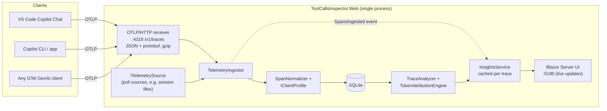

# Tool Calls Inspector

> [!WARNING]
> **AI-generated code, for presentation purposes only.** This code was created by AI and has not been reviewed by the repository owner. It is intended for demos and presentations only, not for production use.

A local .NET 10 + Blazor app that shows where GitHub Copilot's tokens go. You can see every LLM call, every tool call, how they connect within a conversation, and how each call's prompt breaks down (system prompt, your context, history, tool results, …).

## Why OpenTelemetry and not hooks?

Copilot hooks (`PreToolUse`, `PostToolUse`, …) see tool calls but **not token usage**. VS Code Copilot Chat and the Copilot CLI already export **OpenTelemetry** traces that follow the [GenAI semantic conventions](https://opentelemetry.io/docs/specs/semconv/gen-ai/). Every LLM call is a span with exact token counts. Tool calls and the agent loop are spans in the same trace. The inspector is simply a local OTLP receiver with an analysis engine and UI on top. (Hook executions also show up as spans.)

## Architecture



| Project | Responsibility |
|---|---|
| `src/ToolCallsInspector.Core` | Transport-neutral span model, client profiles, normalization, SQLite storage (EF Core), correlation and token attribution, `InsightsService` |
| `src/ToolCallsInspector.Ingestion.Otlp` | OTLP/HTTP trace receiver (`MapOtlpReceiver()`); JSON and protobuf parsers |
| `src/ToolCallsInspector.Web` | Blazor Interactive Server UI, hosting, demo data |
| `tests/ToolCallsInspector.Tests` | Parser, attribution, correlation and end-to-end tests |

## Running

Requires the .NET 10 SDK.

### Everything at once with Aspire (recommended)

```powershell
dotnet run --project src/ToolCallsInspector.AppHost
```

This starts the inspector and the warm weather sample API together, and opens the **Aspire dashboard** at <http://localhost:15180>. The dashboard shows resource state, health, console logs and links. In Visual Studio or Rider, set `ToolCallsInspector.AppHost` as the startup project and press F5.

| Resource | URL |
| --- | --- |
| `inspector` | Token dashboard <http://localhost:5180>, OTLP receiver <http://localhost:4318> |
| `weather-api` | <http://localhost:5190> (MCP at `/mcp`) |

The ports are fixed and not proxied, because Copilot clients export to `:4318` and the MCP config points at `:5190`. Aspire injects `OTEL_*` variables for its own dashboard. Neither app uses an OTel SDK, so these do nothing, and the inspector never sends its own telemetry to itself.

### Just the inspector

```powershell
dotnet run --project src/ToolCallsInspector.Web
```

- UI: <http://localhost:5180>
- OTLP receiver: <http://localhost:4318/v1/traces> (`/v1/logs` and `/v1/metrics` are accepted and ignored)
- Data: `%LOCALAPPDATA%\ToolCallsInspector\inspector.db`. Override with `Inspector:DatabasePath` (e.g. env var `Inspector__DatabasePath`).

No client set up yet? Use **Setup → Load demo data**. To wipe everything, use **🗑️ Clear all data** at the bottom of the sidebar (or on the Setup page). It asks for confirmation, deletes all captured telemetry and compacts the SQLite file.

```powershell
dotnet test
```

## Connecting VS Code Copilot Chat

Add to `settings.json` and reload the window:

```jsonc
{
  "github.copilot.chat.otel.enabled": true,
  "github.copilot.chat.otel.exporterType": "otlp-http",
  "github.copilot.chat.otel.otlpEndpoint": "http://localhost:4318",
  "github.copilot.chat.otel.captureContent": true
}
```

`captureContent` adds prompts, responses, system instructions and tool arguments/results to the spans. It is optional, but it enables content-based attribution and the message viewer. Data only goes to this local process.

## Connecting the Copilot CLI / Copilot app

The CLI exports OTel as soon as `OTEL_EXPORTER_OTLP_ENDPOINT` is set (`copilot help monitoring` has the full list). It reports `service.name = github-copilot`.

```powershell
# This terminal only, then run `copilot`
$env:OTEL_EXPORTER_OTLP_ENDPOINT = "http://localhost:4318"
$env:OTEL_INSTRUMENTATION_GENAI_CAPTURE_MESSAGE_CONTENT = "true"

# Permanently. The Copilot app runs the CLI, so this also covers the app. Restart the app afterwards.
setx OTEL_EXPORTER_OTLP_ENDPOINT "http://localhost:4318"
setx OTEL_INSTRUMENTATION_GENAI_CAPTURE_MESSAGE_CONTENT "true"
```

The CLI captures only the messages that are **new** since the previous LLM call. The inspector rebuilds the full prompt by appending each call's input to the previous call's prompt and response.

## Connecting Claude Code

> [!NOTE]
> Claude Code support is built from Anthropic's [monitoring docs](https://code.claude.com/docs/en/monitoring-usage) and tested with synthetic spans and transcripts only. It has **not** been verified against a live Claude Code install yet.

Claude Code's trace export is a beta. Put the variables in the `env` block of your **user** settings, `~/.claude/settings.json`. Claude Code ignores exporter settings in a repository's `.claude/settings.json`. You can also export them in your shell:

```json
{
  "env": {
    "CLAUDE_CODE_ENABLE_TELEMETRY": "1",
    "CLAUDE_CODE_ENHANCED_TELEMETRY_BETA": "1",
    "OTEL_TRACES_EXPORTER": "otlp",
    "OTEL_EXPORTER_OTLP_PROTOCOL": "http/json",
    "OTEL_EXPORTER_OTLP_ENDPOINT": "http://localhost:4318",
    "OTEL_LOG_USER_PROMPTS": "1",
    "OTEL_LOG_TOOL_DETAILS": "1",
    "OTEL_LOG_TOOL_CONTENT": "1",
    "OTEL_LOG_RAW_API_BODIES": "file:C:\\Users\\<you>\\.claude\\api-bodies"
  }
}
```

`OTEL_LOG_RAW_API_BODIES` is optional but recommended. It makes the breakdown exact (see [Exact requests from Claude Code's API body log](#exact-requests-from-claude-codes-api-body-log)). Use the absolute path of your `~/.claude/api-bodies` folder; the Setup page shows yours.

`ClaudeCodeProfile` recognises `claude_code.*` spans or `service.name = claude-code` and maps them as follows:

| Claude Code span | Shown as | Notes |
|---|---|---|
| `claude_code.interaction` | Agent (one per prompt) | The prompt is shown only with `OTEL_LOG_USER_PROMPTS=1`; otherwise it is `<REDACTED>` and the inspector falls back to the transcript. |
| `claude_code.llm_request` | LLM call | Model, tokens, cache, TTFT, stop reason and `query_source`. Claude Code's `input_tokens` **excludes** the prompt cache, so the inspector reports input = `input_tokens + cache_read_tokens + cache_creation_tokens`. That matches the other clients and is what the model actually read. |
| `claude_code.tool` | Tool call | `tool_name`, `tool_use_id`. Arguments come from the file path, command, skill or subagent (needs `OTEL_LOG_TOOL_DETAILS`). The result comes from the `tool.output` event (needs `OTEL_LOG_TOOL_CONTENT`). |
| `claude_code.tool.blocked_on_user`, `claude_code.tool.execution` | Timing spans | Permission wait and execution time; hidden with the timing toggle. |
| `claude_code.hook` | Hook | |

`session.id` correlates the turns of one session. Prompt and response bodies only appear on spans with Claude Code's *detailed beta tracing* (`ENABLE_BETA_TRACING_DETAILED`). That setting redirects traces to its own endpoint and needs allowlisting for interactive sessions. The inspector therefore relies on local files (below) for full prompts.

## Try it: the warm weather sample

`samples/WeatherApi` is a small ASP.NET Core API where the weather is always nice and warm (roughly 24–34 °C, sunny, little rain). The same date and city always return the same report. It also hosts an **MCP server** at `/mcp`, so Copilot can call it as a tool.

| Tool | Purpose |
| --- | --- |
| `get_weather_for_date(date, city?, includeHourly?)` | Weather for one single date (`yyyy-MM-dd`, `today`, `tomorrow`, `yesterday`). Date ranges aren't supported, so multi-day questions take one call per date. `includeHourly` adds 24 hourly entries, which makes a much bigger tool result. |
| `get_current_date()` | Today's date, for resolving "next Friday" and similar. |

REST equivalents: `GET http://localhost:5190/api/weather/2026-08-01?city=Barcelona&hourly=true`. The REST API also has `GET http://localhost:5190/api/weather/forecast?start=today&days=7`, which is deliberately not exposed as a tool.

1. Start the inspector and the weather API: `dotnet run --project src/ToolCallsInspector.AppHost`. Or start them separately with `dotnet run --project src/ToolCallsInspector.Web` and `dotnet run --project samples/WeatherApi` (it listens on <http://localhost:5190>).
2. Register the MCP server. Both configs are already in this repo:
   - **Copilot CLI / Copilot app**: `.mcp.json` (workspace config). Check with `copilot mcp list`. To make it available everywhere, run `copilot mcp add --transport http warm-weather http://localhost:5190/mcp`.
   - **VS Code**: `.vscode/mcp.json`. Open the folder in VS Code and start the `warm-weather` server from the MCP view.
3. Make sure the client exports OTel to the inspector (see the sections above).
4. Ask Copilot, for example: *"What will the weather be like in Amsterdam on 2026-08-01?"*, or *"Give me an hourly forecast for Barcelona tomorrow"* (a large tool result), or *"Compare this weekend in Rome and Oslo"* (several tool calls, one per city and date).
5. Open <http://localhost:5180>. The session shows the prompt, each LLM call, and the `warm-weather-get_weather_for_date` tool call with its arguments and result. You can see how many tokens the result added and what it cost on later calls.

One-shot check from a terminal, without changing your environment permanently:

```powershell
$env:OTEL_EXPORTER_OTLP_ENDPOINT = "http://localhost:4318"
$env:OTEL_INSTRUMENTATION_GENAI_CAPTURE_MESSAGE_CONTENT = "true"
copilot -p "What will the weather be like in Amsterdam on 2026-08-01?" --additional-mcp-config "@.mcp.json" --allow-all-tools
```
## What you get

- **Dashboard**
  - Total tokens, input (fresh vs. cached), output/reasoning and cache hit rate.
  - A "Where did the tokens go?" donut covering LLM output, system prompt, user prompt & context, assistant history, tool results (per tool), tool schemas, and input the client did not capture.
  - Tables by model, by tool and by client, plus recent sessions.
- **Session**
  - Every interaction (agent run) and background request, in order.
  - Each LLM call shows its token counts and a composition bar. The tools it requested are nested beneath it, sub-agents are nested under their `runSubagent` tool call, and hooks are shown inline.
  - A *context growth* chart stacks each call's composition, so you can see tool results accumulate. Click a column to open the call.
- **Traces**
  - *Traces* tab: every trace, newest first, with a mini timeline, models, call counts, duration and tokens. Filter by prompt, model or tool. Traces are grouped under their conversation (one trace per user turn), with per-conversation totals; untick *group by conversation* for a flat list.
  - *LLM calls* tab: a flat log of all LLM traffic. Expand any row to see its request messages, response, system prompt, tool schemas and raw attributes inline.
  - Trace detail (`/traces/{traceId}`): a waterfall of the agent, LLM calls, tools and hooks over time. Click a span to inspect its request/response in the side pane; the URL (`?span=`) is shareable.
- **LLM call**
  - Tokens, cache reads and writes, TTFT, and context used vs. the `max_prompt_tokens` budget.
  - The composition with its attribution method, the tools it requested, and the response.
  - Every prompt message with an estimated token count, plus the system instructions and raw attributes.
- **Tool call**
  - Arguments, result, duration and status.
  - Tokens added to the context, and which LLM call requested it.
- **Tools**
  - *Introduced* tokens: the size of a tool's results when first sent.
  - *Consumed* tokens: what those results cost across every later call, because they are re-sent on each one.
  - Re-send factor, and share of all input.

## How token attribution works

Each `chat` span reports exact `input_tokens` / `output_tokens` (plus cache and reasoning tokens). The categories are a **split of that reported total**:

1. **Content mode** (prompt messages captured and parseable)
   - Each message is tokenized locally with `o200k_base` (+4 tokens per message) and assigned to system / user / assistant / tool (mapped to the tool by `tool_call` id, or by call order). Exported tool definitions (`gen_ai.tool.definitions`) count as *tool schemas*.
   - The result is then fitted to the reported total. If the estimate is too high it is scaled down; any remainder goes to *Not captured*: input the model received but the client did not export (mostly earlier turns). When the prompt was rebuilt from the Copilot session log (see below) it is known to be complete, so a shortfall is a tokenizer difference and the estimates are scaled **up** instead; the request view shows the factor.
2. **Delta mode** (no usable content)
   - Uses the growth in reported input between consecutive calls in the same agent loop.
   - The previous call's visible output (output − reasoning) becomes *assistant history*. The rest goes to the tools that ran in between, weighted by result size. Anything left over is *user context*.
   - When the context shrinks (compaction/summarization), the previous composition is scaled down.
   - The first call of a chain splits off system instructions, the user request and tool schemas; the rest is *Not captured*.

Caveats:

- Category splits are **estimates**; totals are exact. Different models use different tokenizers, and o200k is a proxy for relative sizes.
- VS Code truncates content attributes at 64,000 characters, which breaks the JSON. Those calls fall back to delta mode.
- The Copilot CLI only exports the messages added during the current turn. Without its session log (below), earlier turns (previous prompts, replies and their tool results) are sent to the model and billed, but appear only as *Not captured*; the request view flags calls where this is a large share. This also applies in delta mode. Prompts are reconstructed within one agent run, not across runs.
- `invoke_agent` spans carry summed usage. They are never added on top of the `chat` spans, so nothing is counted twice.

### Full prompts from the Copilot session log

The Copilot CLI (and the Copilot app, which runs it) writes the complete transcript to `~/.copilot/session-state/<session id>/events.jsonl`. The session id equals the span's `gen_ai.conversation.id`, and every `assistant.message` carries an `apiCallId` equal to the span's `gen_ai.response.id`. The inspector replays that log to rebuild the full prompt each LLM call was sent: system prompt, all earlier turns, tool calls and tool results, with compaction summaries applied. It then shows that prompt instead of the partial telemetry, marked *📜 Full prompt*.

- On by default when the inspector runs on the same machine as the CLI. Location: `COPILOT_HOME` or `~/.copilot/session-state`. Override with `Inspector:CopilotSessionStatePath`; set it to an empty string to disable.
- The log is read-only and parsed incrementally. Nothing is stored in the database; the prompt is rebuilt when you view it.
- This is a faithful reconstruction, not the exact wire request. Encrypted reasoning blocks, attachments and injected hook context are not included verbatim, and the provider's tokenizer differs from o200k (Claude counted ~1.45× more tokens for the same prompt in testing). Category totals are therefore scaled to the billed input tokens. Only an intercepting proxy would show the exact bytes.
- **📤 Full request** (LLM calls) assembles everything sent with that call into one provider-neutral JSON document: model, system prompt, tool schemas and messages (the full history when the session log is available). Each part shows its size and can be expanded and copied, and the whole document can be copied at once.
- **{ } Raw log** (on LLM and tool call panels and detail pages) opens the raw log lines for that call, prettified, with their line numbers. LLM calls match on `apiCallId` (`assistant.message` with the model's reply, `session.usage_record` with usage); tool calls match on `toolCallId` (`tool.execution_start` with the arguments, `tool.execution_complete` with the result). The CLI does not log outgoing LLM requests, so use Full request for those.
- All JSON in the UI (payloads, attributes, overlays) is pretty-printed and syntax highlighted server-side; plain text is shown as-is.

### Full prompts from the Claude Code transcript

Claude Code writes each session to `~/.claude/projects/<project>/<session id>.jsonl`. Every line has a `uuid` and a `parentUuid`, and assistant lines carry the API `requestId`, which equals the span's `request_id`. To rebuild the prompt for a call, the inspector walks back up the parent chain from that call's first response line. It merges streamed lines that belong to one response, maps `tool_use`/`tool_result` blocks to tool calls and results, and stops at a compaction boundary, where the summary starts the new history. Rewound branches and synthetic error messages are left out. **{ } Raw log** matches on `requestId`, `message.id` and tool use ids.

- Location: `CLAUDE_CONFIG_DIR` or `~/.claude`, then `projects`. Override with `Inspector:ClaudeProjectsPath`; set it to an empty string to disable.
- The transcript has no system prompt, tool schemas or CLAUDE.md. That part of the billed input (often 15–20K tokens) stays *Not captured* unless the API body log below is enabled. The inspector only scales estimates up to the billed input when the system prompt is known, so the history and tool-result figures are not inflated to cover it.
- Subagent transcripts, which newer versions keep in separate files, are not read yet. Subagent calls show their telemetry only.

### Exact requests from Claude Code's API body log

With `OTEL_LOG_RAW_API_BODIES=file:<dir>`, Claude Code writes the exact Messages API request of every model call to `<dir>/<uuid>.request.json`, and the response to `<dir>/<request id>.response.json`. Since v2.1.274 it also appends a line to `<dir>/index.jsonl` with the `session_id`, the `request_id` and both file names. The inspector reads that index, so it needs v2.1.274 or later.

- A request body holds the system prompt (including CLAUDE.md), the tool schemas and every message, so the request view shows the real prompt and the breakdown has no *Not captured* share. Earlier thinking blocks are redacted by Claude Code. Estimates are scaled to the billed input as for the Copilot session log.
- The body log takes precedence; calls missing from the index fall back to the transcript. **{ } Raw log** still uses the transcript.
- Location: `CLAUDE_CONFIG_DIR` or `~/.claude`, then `api-bodies`. Override with `Inspector:ClaudeApiBodiesPath`; set it to an empty string to disable. Body files named in the index are only read when they lie inside that folder.
- Claude Code's inline mode (`OTEL_LOG_RAW_API_BODIES=1`) sends truncated bodies as OTLP log events, which the inspector does not receive; use file mode.
- **Privacy:** these files contain your full conversations, including file contents and command output. Claude Code does not clean them up; delete the folder when you're done.

## Extending to other clients

The pipeline is client-agnostic:

- **`IClientProfile`** (`Core/Clients`) detects a client from resource/span attributes. It can categorize spans the GenAI conventions don't cover, and it fills the normalized fields before the generic derivations run. `ClaudeCodeProfile` is a complete example of a client with its own attribute names.
- **`ITranscriptSource`** (`Core/Transcripts`) rebuilds full prompts from a client's local log. Derive from `LocalTranscriptSource` (locating the file and caching) and `JsonlTranscript` (incremental tailing and the raw-line index), and register it as an `ITranscriptSource` singleton. `TranscriptEnricher` asks each source in turn, so an exact source can precede a reconstructing one; set `ProvidesEvents => false` on a source without raw log lines.
- **OTLP push**: any client that exports OTLP/HTTP (JSON or protobuf) to `http://localhost:4318` works unchanged. The env vars shown on the Setup page are the standard `OTEL_EXPORTER_OTLP_*` variables plus the `COPILOT_OTEL_*` switches VS Code uses. **Check the CLI's own docs for its exact opt-in variables.**
- **`ITelemetrySource`** is for pull-based sources, for example reading the Copilot CLI's local `~/.copilot/session-state/*/events.jsonl` and its `session-store.db` usage table. Implement it, map records to `RawSpan` using the GenAI attribute names (`GenAiKeys`), and register it with `services.AddTelemetrySource<MySource>()`. `TelemetrySourceHost` runs it and feeds the same ingestor.

## Project layout

```
src/
  ToolCallsInspector.AppHost/          Aspire AppHost: starts the inspector + weather sample
  ToolCallsInspector.Core/
    Telemetry/       RawSpan, attribute helpers, ITelemetryIngestor/ITelemetrySource
    Clients/         IClientProfile + VS Code / CLI / Claude Code / generic profiles
    Transcripts/     ITranscriptSource: Copilot session log, Claude Code transcript and API body log readers
    Normalization/   GenAI attribute keys, SpanNormalizer
    Storage/         SpanRecord/SpanContent, EF Core SQLite store
    Ingestion/       TelemetryIngestor, InspectorEvents, IngestionStatus
    Analysis/        TraceAnalyzer, TokenAttributionEngine, InsightsService, totals
  ToolCallsInspector.Ingestion.Otlp/   OTLP protos, JSON/protobuf parsers, endpoints
  ToolCallsInspector.Web/              Blazor UI (Components/), services
samples/WeatherApi/                    Warm weather REST API + MCP server (/mcp) for demos
tests/ToolCallsInspector.Tests/
tests/WeatherApi.Tests/
```
